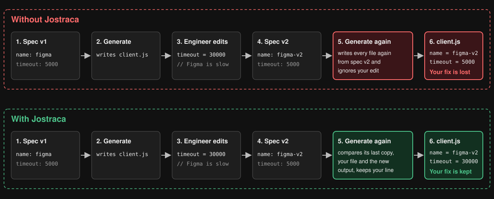
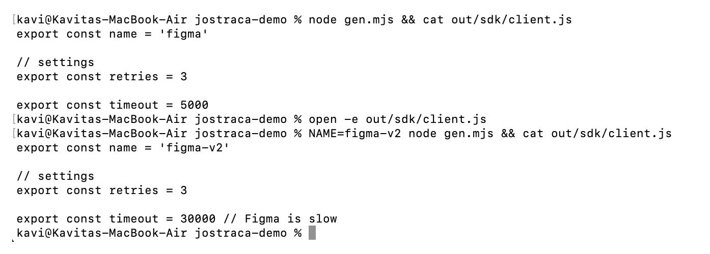
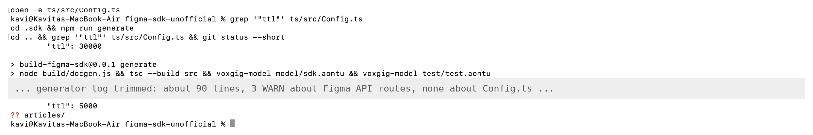
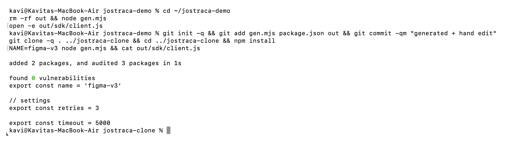

# Can Jostraca regenerate code without losing your edits? I tested it on a Figma SDK

*Tested with jostraca 0.40.0, @voxgig/sdkgen 4.35.0 and @voxgig/model 12.0.1 on macOS.*

Software engineers who maintain generated code run into the same problem every time the source spec changes. They have to run the code generator again, and the generator writes its files over the ones their team has since fixed by hand. In that moment, a code generator works like a printer that reprints a corrected textbook onto the very copy you have annotated in pencil: the new edition comes out right, and your notes disappear under the ink. The hard part of regeneration is deciding which changes the generator should replace and which ones it should keep.

Jostraca, a code generator written by Richard Rodger, is built to do better. It keeps a copy of what it generated last time, so on the next run it can see which lines you changed and leave them in place. The diagram below follows one file through the same six steps with and without Jostraca.



In this post I explain how Jostraca does this and then test it in three experiments. The first checks that the merge works when it is switched on. The second tests it inside Voxgig's SDK generator, which uses Jostraca to write every file and which I used earlier this week to build a Figma SDK. The third tests what happens on a fresh clone of a project, where Jostraca's last copy is missing.

## Why regenerating code is a hassle, and how Jostraca handles it

A code generator reads a specification, such as an [OpenAPI](https://www.openapis.org/) document that lists every endpoint of a web API, and writes source code from it. Teams that publish an API use tools like [OpenAPI Generator](https://openapi-generator.tech/) to produce SDKs for their customers in several languages, because keeping five hand-written clients in step with every API change is slow work that invites mistakes. Ideally, fixes to those SDKs belong in the specification, the generator's configuration or a hand-written extension point. Some fixes, however, such as a timeout tuned for one slow endpoint, depend on how the client behaves at runtime, and the generator may offer nowhere else to put them. Once a fix has to live in a generated file, regenerating that file becomes a merge problem, and generator tools have settled on three ways of handling it:

| Approach | Used by | How it keeps your edit | What you give up |
|---|---|---|---|
| Ignore file | [OpenAPI Generator](https://openapi-generator.tech/) | Files you list are never written again | Those files stop receiving updates |
| Marked regions | [Speakeasy](https://www.speakeasy.com/) | Code between comment markers is carried into each new version | Your code has to fit inside those regions |
| Three-way merge | [Fern](https://buildwithfern.com/), Jostraca | The generator compares its last copy, your file and its new output, and keeps the lines only you changed | The last copy has to be available |

### Installing Jostraca

Jostraca needs Node.js 20 or later. In an empty folder, create a project and install it from npm:

```console
$ mkdir jostraca-demo && cd jostraca-demo
$ npm init -y
$ npm install jostraca
```

### Getting started with Jostraca

In Jostraca you write the generator itself as ordinary JavaScript or TypeScript, and the values come from a model through `$$path$$` placeholders. This is the generator I used for the experiments; the `merge: true` setting tells Jostraca to merge instead of overwriting.

```js
// gen.mjs
import { Jostraca, Project, File, Content } from 'jostraca'

const jostraca = Jostraca({
  model: { api: { name: process.env.NAME || 'figma', timeout: 5000 } },
  existing: { txt: { write: true, merge: true } },
})

await jostraca.generate({ folder: './out' }, () => {
  Project({ folder: 'sdk' }, () => {
    File({ name: 'client.js' }, () => {
      Content(
        "export const name = '$$api.name$$'\n\n" +
        "// settings\nexport const retries = 3\n\n" +
        "export const timeout = $$api.timeout$$\n")
    })
  })
})
```

The generator writes its output to `out/sdk/client.js`, so in each experiment below I show that file with `cat` after the run.

## Experiment 1: a small generator with merge on

Jostraca keeps its last copy of every generated file in a `.jostraca/` folder beside the output. I generated the client, raised the timeout by hand in a text editor, changed the API name in the model and ran the generator again:



Both changes survived: the new name came from the generator and the timeout came from me. When I edited a line directly next to one the generator had changed, Jostraca wrote git-style conflict markers instead, so that I could choose between the two versions myself. In this configuration, Jostraca preserves the edit as intended.

## Experiment 2: the Figma SDK

My [Figma SDK](https://github.com/KaviRana/figma-sdk-unofficial) provides TypeScript and Python clients for the [Figma REST API](https://developers.figma.com/docs/rest-api/) and is not affiliated with Figma. Voxgig's SDK generator, [`@voxgig/sdkgen`](https://github.com/voxgig/sdkgen), reads Figma's OpenAPI document and hands the files to Jostraca, which keeps its last copy of the 419 generated files in `.jostraca/generated`. I raised a cache setting by hand in `ts/src/Config.ts` and ran the SDK's standard generate command, `npm run generate`:



The TTL reverted without a warning, and `git status` listed nothing under `ts/`; the only entry, `articles/`, is this post's folder. The cause is in sdkgen's configuration: by default it creates Jostraca with merging disabled, and `npm run generate` does not override that default.

```js
existing: { txt: { write: true, merge: false } }
```

Yet the guide that sdkgen writes into every SDK for AI coding agents says that `generate` "merges into existing files". An AI coding agent that trusts the guide would fix generated files directly and lose those fixes on the next run, and since I built this SDK with one, the scenario is a practical one. Under this default, an edit survives only if the file contains the text `JOSTRACA_PROTECT` or the generator's own components exclude that file, and in both cases the file stops receiving the generator's updates.

## Experiment 3: a fresh clone

Unless `control.version` is set to `true`, Jostraca writes a `.gitignore` inside `.jostraca/` that keeps its last copy out of git, so a colleague who clones the repository, or a CI job on a clean machine, starts without the last copy that the merge depends on. Jostraca's documentation says the first merge in that case "degrades to a two-way comparison". To test it, I committed the project from Experiment 1 with my timeout edit, cloned the repository into a new folder, installed it and ran the generator there:



In version 0.40.0, when the last copy of a file is missing, Jostraca skips the merge and, because writing is on, overwrites the file without conflict markers or a warning. Setting `control.version: true` keeps the last copy in git, but the default workflow does not warn users that losing it defeats the merge.

## End notes

When the last copy is missing and a file on disk differs from the new output, Jostraca could write the new version beside it as a `.new` file instead of overwriting it, and it could warn whenever merging is on while `.jostraca/` is ignored by git. Separately, sdkgen should either switch merging on or correct its agent guide.

Jostraca takes on a problem that a plain generator leaves to you, and in a project where merging is on and the last copy is committed, it keeps hand edits exactly as it promises. I would use it with `control.version: true` set from the first commit. Through sdkgen as it ships today, however, I would treat generated files as read-only and put fixes into the specification instead.

## Sources

- Jostraca: [jostraca.org](https://jostraca.org/), [Explanation](https://jostraca.org/docs/explanation), [GitHub](https://github.com/jostraca/jostraca), [npm](https://www.npmjs.com/package/jostraca)
- OpenAPI Generator: [openapi-generator.tech](https://openapi-generator.tech/)
- How SDK generators keep custom code (Fern, a vendor): [buildwithfern.com](https://buildwithfern.com/post/custom-code-preservation-tools-sdk-maintenance)
- My Figma SDK and the demo generator: [figma-sdk-unofficial](https://github.com/KaviRana/figma-sdk-unofficial)
